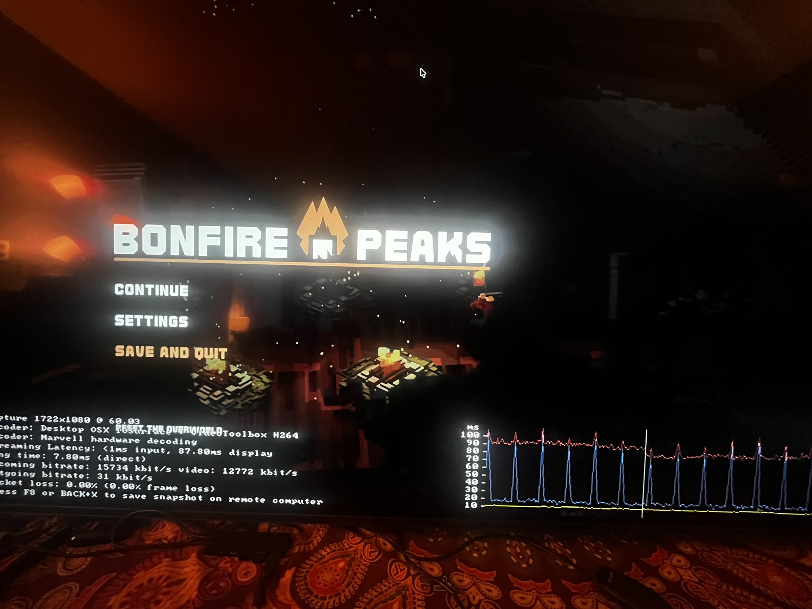

---
# Generated from the Obsidian vault by scripts/vault_export.py. Edit the note there.
title: Debugging SteamLink Streaming Issues
date: 2026-10-17T16:32:15-07:00
tags:
  - TIL
  - gaming
---
When debugging streaming issues with SteamLink, their built-in latency graph is very useful. You might be able to get it to display with F6 or you might just need to go to Settings > Remote Play > Performance Overlay > Show Details. Here is what it looks like (older graphs replace the yellow line with a light blue line):

The documentation for the graph's color coding seems limited to an [outdated 2014 forum post](https://steamcommunity.com/groups/homestream/discussions/0/540732889636623310/#c540732889652053359), but as far as I can tell, the blue is host encoding time, the yellow is the network time, the red is the client decode time.

To cut network problems out of the picture, hardwire the host and the client - even with a fast WiFi router, interference from other devices is degrades connection and is hard to control (especially in heavy residential areas). Make sure your ethernet cable is Cat 5 or higher and your network switch (if you use one) is 1Gbps or higher. 

Also Steam gives you the option to keep the bitrate and frame rate either at a fixed cap or "Automatic (recommended)". My personal preference is to set FPS at 60 (see below) and cap the bandwidth at a fixed 75 Mbps to rule out their adaptive algorithms when debugging.

One major issue I ran into was periodically degrading video stuttering - game streams fine for 20 seconds, then decode times start rising in waves, leading to bigger and bigger stutters, until the screen goes black and completely resets to start the cycle anew. The whole problem was fixed by capping the stream FPS rate to 60Hz - turns out my Sony Bravia's hardware decoder only supports decoding at 60Hz and fails haphazardly by degrading its decode (I'd guess there might not be standards for a stream client to reject frames? not sure why they don't just sample the frames down).

If you're seeing encoding problems, make sure you stream in a format your video card supports (mine is 3070, so I have to use HEVC / H.265 rather than AV1).

Another major problem I ran into is controller latency. I have an Xbox Bluetooth controller I use for most gaming. I found that:

- directly connecting your controller to the TV is not a good idea - with my Sony Bravia TV, either its driver is aimed at browsing Netflix rather than playing Silksong or its receiver is self-interfering with the screen, but regardless, the latency is quite bad and I was not able to address it
- the unfortunate part about this is that your alternatives are to hardware your controller or find a dedicated USB wireless receiver dongle
	- hardwiring is challenging since USB cables longer than 5 meters aren't very reliable without active power hubs along the path - my 25ft cable did not perform well; it's also just not very convenient to have to wire you controller in to a hub hidden behind a couch
	- I use the Microsoft Xbox Wireless Adapter and it works well plugged into the original SteamLink hardware box; it's a bit of a gamble whether it will work plugged directly into the TV

I would also recommend testing controller latency by playing a challenging level from a reflex intensive game like Silksong or Celeste with and without streaming. This is because latency differences between 5ms and 50ms can be hard to measure and might feel like placebo effects. I found that my success rate at Silksong combat was drastically different between the two, which convinced me to invest in a dedicated dongle.
